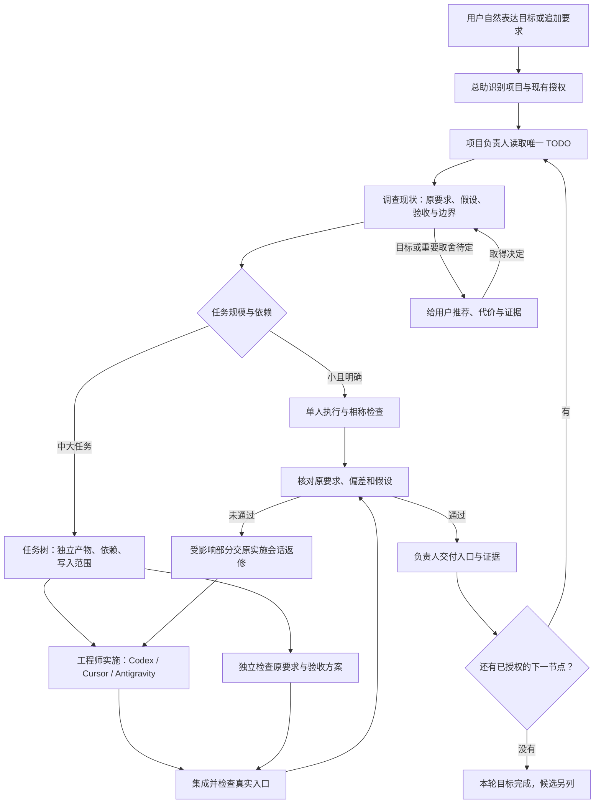

# Grok 多 Bot 协作工作流

**把一句自然语言需求，接成可检查、可接续、可交付的工作。**

这是一套给 Grok Bot 总助、项目负责人，以及 Codex、Cursor、Antigravity 工程师使用的提示词和操作文档。用户照常说“重构这个 App”“继续做”“现在到哪了”；Bot 负责补齐上下文、拆分任务、选择工具、核查结果和接续下一步。

运行方式是 **提示词 + 已有原生工具 + 项目唯一 TODO**。仓库不包含协调服务、后台执行器或模型 API 密钥。

> 状态：实验性工作流，v0.1.0。实际环境中做过角色配置保存、回读及部分文件可达性核查；本公开版尚未完成独立的真实任务全流程验收。可作为部署起点，不能据此承诺无人值守可靠性。验证范围见 [验证说明](docs/validation.md)。

English: A prompt-based collaboration workflow for Grok Bot with Codex, Cursor and Antigravity engineers. It covers ambiguous requirements, multiple projects, evidence-based status, practical parallelism, session continuity, independent acceptance and delivery. No custom orchestration server is included. Experimental; validate it in your own environment.

## 解决什么问题

| 经常发生的事 | 工作流怎样处理 |
| --- | --- |
| 说“在做”，实际没开工 | 送达、原生开始、有效活动、验收、交付分别取证 |
| 转派后要求丢了 | 保留原话；中大任务用要求编号串起派单、检查和交付 |
| 只说“重构”，需求不完整 | 先调查动机和现状，区分事实与假设，推进已有授权的共同准备 |
| 复用了会话，仍然全程串行 | 按独立产物、依赖、文件和资源决定并行，写明理由 |
| 管理者不懂某个技术领域 | 把技术建议改写为可验证主张，引入独立检查和有限试验 |
| 项目太多、做太久，丢上下文 | 每项目一份 TODO，顶部回答“现在这件事”；总览只保存指针 |
| 直接找工程师，负责人不知道 | 工程师同步需求变化和证据，用户不用充当传话人 |
| 阶段完成后没人接下去 | 项目负责人接续已授权下一节点，实际验证通知与补查入口 |
| 几个 Agent 都说“没问题” | 从原始要求独立设计检查，绑定同一受检版本，验证真实入口 |
| 过程太贵、消息太多 | 按任务大小裁剪流程，按需加载文档，区分调用成本与人工介入 |

## 整个流程

图中的两条工作线代表不同职责，不规定人数或并发数量。方案检查可以提前并行；最终验收必须针对实际集成后的产物。

## 怎么开始

1. 下载或克隆本仓库，把文件放到各 Bot 通过已有授权工具实际能读取的位置。
2. 按 [部署说明](DEPLOY.md) 备份当前设定，合并角色职责，填入你自己的文件位置、项目和工具入口。
3. 将 [核心规则](WORKFLOW.md) 和对应 [角色卡](roles/) 中必要部分写入 Bot 持久设定；按需流程保留为文件指针。
4. 每个角色通过自己的入口读取规则，核对保存后的设定。选择一个已经授权的真实任务验证；记录失败和人工纠正，不只收“收到”。

可以直接给负责部署的 Bot 这段话，并附上本仓库地址或它能读取的目录：

> 请读取仓库里的 DEPLOY.md，在现有授权范围内合并部署这套工作流。先核对已有角色、项目、原生会话和实际工具入口，保留我的现有职责和限制，处理冲突条款。完成后回报实际改动、保存回读和各角色读取证据，分别标清配置完成与真实任务验证。已有任务在自然阶段接入，避免重复执行。

## 文档入口

| 要做什么 | 读哪里 |
| --- | --- |
| 看一页核心规则 | [WORKFLOW.md](WORKFLOW.md) |
| 安装、回退、确认谁能读文件 | [DEPLOY.md](DEPLOY.md) |
| 配总助、负责人、三位工程师、临时验收者 | [roles/](roles/) |
| 接续、并行、诊断、集成交付 | [flows/](flows/) |
| 项目登记、任务树、消息与交付模板 | [templates/](templates/) |
| 判断进度证据够不够 | [状态与证据](docs/state-evidence.md) |
| 选择验收方法 | [验收清单](docs/acceptance.md) |
| 处理成本与专业判断不对称 | [成本与技术决策](docs/cost-and-decisions.md) |
| 看完整情境 | [示例](docs/examples.md) |
| 登记当前工具真正能做什么 | [能力表](docs/tool-capabilities.md) |
| 看验证边界和改进方向 | [验证说明](docs/validation.md)、[TODO](TODO.md) |

## 几个关键约定

- 先拆清目标，再决定同时做哪些事；没有通用的“最多两个会话”或“返修两轮就结束”。实际投入边界来自用户授权、工具限制和任务证据。
- 同一任务优先接续正确的原生会话；多个独立工作可以分别使用合适的既有会话或原生子代理。复用不等于全项目只有一条执行线。
- 文件在一个目录，不意味着所有工作都冲突；Git 分支不同，也不意味着工作区已经隔离。
- 每个项目只有一个当前进度来源。总助组织跨项目工作，项目负责人对本项目交付负责。
- 提示词不能创造工具权限、可靠定时器或硬预算。能力不存在或未验证时，应记录缺口并调整安排。

## 许可与贡献

采用 [MIT License](LICENSE)。欢迎通过 Issue 提交脱敏的失败案例，或按 [贡献说明](CONTRIBUTING.md) 提交改进。

这是独立社区项目，与 Grok、OpenAI、Cursor 或 Google 没有官方隶属关系。工具名称仅用于说明适配对象。
